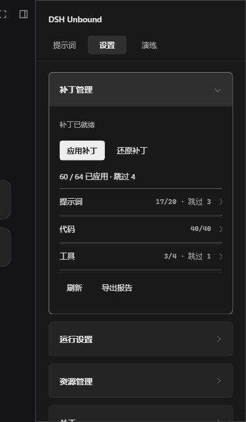
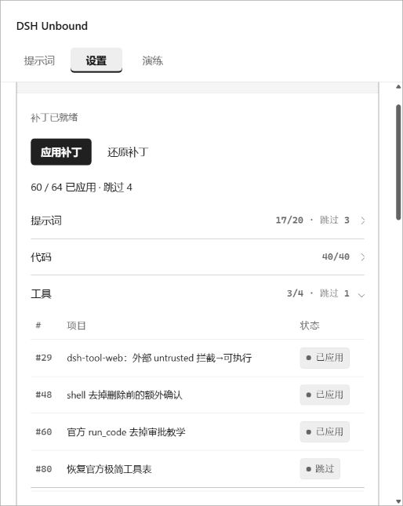

# DSH Unbound · 模型破甲与本地限制调整

**面向 DeepSeek-V4.1-Flash 1017 的模型破甲插件，在 DeepSeek Harness 中管理提示词注入、宿主限制调整与补丁恢复。**

DSH Unbound 将提示词配置和本地宿主补丁集中到同一入口，用于调整系统提示词组合、部分审批流程、沙箱及工具执行路径，并提供补丁状态查看、还原、规则与技能管理以及授权演练工具。

这里的“破甲”指提示词与本地宿主层面的行为调整，不是重新训练模型，也不改变模型服务提供方的服务器配置。实际响应仍受模型、服务端策略、上下文及工具环境影响；项目不承诺解除全部限制，也不以模型自称“可以做到”作为能力验证。

## 核心功能

### 提示词注入

编辑、保存或恢复系统提示词，管理自定义内容与宿主提示的组合。适用于配置交互方式、任务要求和工作流。已有私人提示词由使用者自行管理，公开安装包不包含维护者的私人角色设定。

### 本地运行限制调整

通过宿主补丁调整部分审批、沙箱和工具执行路径，提供 Hooks 结果处理与网络范围选项。补丁影响本机 Harness 的相应执行逻辑，不授予第三方系统访问权限，也不保证外部服务接受请求。启用前应了解具体选项及其对执行控制的影响。

### 补丁管理与恢复

按提示词、代码、工具分类查看补丁数量、编号、用途与状态，支持应用和还原。已应用、跳过、未匹配应分别判断；“已就绪”只表示本地识别结果，不表示模型行为及全部工具均已验证。还原补丁不会撤销已经发生的文件修改、网络请求或外部操作。





### 规则、技能与授权演练

集中管理工作区规则和技能，在演练台中组织任务、资产及工具。外部工具需要单独安装或配置；进入演练台须主动确认使用规范及授权承诺，该确认不代替目标所有者的有效授权。

### 脱敏诊断

导出插件与宿主版本、补丁编号和状态，用于排查安装、重复注册及补丁匹配问题。报告按限定字段生成，不包含私人提示词、账户凭据或原始路径，不自动上传；提交前仍应检查实际内容。诊断不调用模型，也不证明备份完整或所有功能可用。

## 适用版本

| 项目 | 版本 |
| --- | --- |
| DSH Unbound | 1.0.0 |
| 目标模型 | DeepSeek-V4.1-Flash 1017 |
| 已验证宿主 | DeepSeek Harness 0.2.1-rc.2 |

模型标识与宿主版本是两个不同维度。本版围绕上述组合维护，其他组合不在已验证范围内。验证范围与限制见 [SUPPORT.md](SUPPORT.md)。


## 安装

从 [v1.0.0 发布页](https://github.com/baihangyu486-blip/dsh-unbound/releases/tag/v1.0.0) 下载安装包并核对 SHA256。

1. 在插件管理中停用已有的 dsh-purge，完全退出 DSH。
2. 安装：

```powershell
dsh plugin --profile desktop add "C:\path\to\dsh-unbound-1.0.0.tgz"
```

Web 使用 `--profile web`。

3. 启动 DSH，启用 DSH Unbound。若未登记插件，在源码目录执行：

```powershell
node scripts/activate-profile.mjs --profile desktop
```

4. 打开 **Unbound → 设置**，核对宿主路径后应用补丁，完全退出并重新打开 DSH。

首次应用前保留同版宿主备份。提示词保存在 `$DSH_HOME/prompt-inject.md`，安装不覆盖已有内容。使用本地安装包更新。

## 来源、贡献与许可

DSH Unbound 基于 **小杨 / YuJunZhiXue** 的 [dsh-purge](https://github.com/YuJunZhiXue/dsh-purge) 衍生开发。采用的上游基线为 **1.1.71**，对应提交 [6c1d638d1bdcc45ede50fc30249c753d58122a51](https://github.com/YuJunZhiXue/dsh-purge/tree/6c1d638d1bdcc45ede50fc30249c753d58122a51)。

上游提供了核心补丁、命令行、演练模块、预设、技能及客户端构建基础。DSH Unbound 在此基础上进行了目标宿主兼容调整、界面与交互整理、脱敏诊断导出、使用规范及发布验证工具的补充。核心能力的来源归属于上游，新增维护工作不改变原有代码的著作权归属。感谢原作者提供的技术基础与公开成果。

[LICENSE](LICENSE) 保留上游版权声明与 MIT 许可原文；上游同一提交的 README 另含非商业及许可终止表述，与标准 MIT 存在不一致，尚未取得书面澄清。项目不将该差异解释为已获得额外授权，具体来源与许可情况见 [NOTICE.md](NOTICE.md)。

DSH Unbound 由本仓库维护者独立维护，与 DeepSeek 无隶属、认证或背书关系，也不代表上游作者对本衍生版本提供支持或承担维护承诺。


## 使用与演练声明

本规范说明项目用途、操作边界、数据处理及风险责任。使用前请结合适用法律、软件许可、目标系统规则及服务协议阅读。本规范不构成针对特定活动的法律意见，也不为任何目标授予访问权限。适用中华人民共和国法律的活动须遵守相应法律法规；在其他国家或地区开展活动时，还应遵守适用的当地法律及跨境处理要求。

### 一、项目定位与立场

DSH Unbound 是独立维护的社区项目，用于个人工作流配置、提示词管理、宿主兼容维护，以及合法授权环境中的研究与演练。本项目不代表 DeepSeek 或其他服务提供方，不属于其官方产品、认证方案或安全承诺。

项目支持负责任的研究、最小影响验证和可复核的技术交流，反对借助自动化侵害他人权益、破坏系统或规避应承担的责任。功能存在、界面可用、模型愿意回答或任务执行成功，均不表示行为合法、得到授权或适合实施。

### 二、许可与权利来源

代码使用、复制、修改和分发的权利以适用的软件许可证及相关权利来源为准，参见 LICENSE 与 NOTICE.md。本规范不替代软件许可，不因界面确认而追加或撤销开源许可证授予的权利，也不把上游代码归属改为本项目所有。

获得软件使用权，不等于取得目标系统、模型服务、数据、商标或第三方内容的使用权。第三方工具和服务可能适用独立协议；操作者应分别确认其要求，不能以本规范替代这些义务。

### 三、适当用途

在满足适用法律、服务条款及必要授权的前提下，可用于个人提示词与工作流配置、隔离实验室和自有测试靶场、教学示范、授权安全评估、防御规则验证、故障复现、兼容性研究，以及对自身系统的修复验证。经有效书面授权，可用于渗透测试、漏洞验证、代码审计，以及企业内部合规安全能力建设和自动化检测研究。

公开可访问、开源、存在漏洞或缺少登录限制，不代表允许任意测试。自有账户也不当然包含对平台基础设施、其他租户、共享资源或关联第三方的测试权限。

### 四、授权与范围

开展涉及外部系统的演练前，应确认授权方有权授予相应权限，并取得可核验的授权记录。记录应覆盖资产和账户、测试方式、允许的工具、执行时间、访问频率、数据处理、结果接收方、停止条件及应急联系人；必要时另行取得云服务商或其他权利人的许可。

授权仅适用于约定范围，不自动延伸至跳转地址、供应链、相邻网段、其他租户或意外发现的系统。范围不明、授权过期、授权被撤回或出现争议时，应先停止相关操作并重新确认。界面中的阅读确认仅记录声明版本和时间，不是授权书，也不验证资产所有权。

### 五、禁止行为

不得将本项目用于未经授权的访问、越权操作、窃取或滥用凭据、个人信息及商业秘密，或者用于欺诈、勒索、骚扰、跟踪、恶意冒用身份及其他侵害合法权益的活动。

不得实施恶意植入、未经许可的持久化控制、数据篡改或销毁、服务中断、资源滥用，也不得通过模型或工具协助掩盖违法行为、破坏审计证据或规避依法设置的安全措施。不得绕过付费、身份验证、访问控制或服务配额来获取未经许可的资源。

不得以“研究”“演练”“模型生成”或“开源工具”为由替代授权。不得公开泄露凭据、可识别个人的数据、未获准披露的业务信息或足以直接危害他人系统的敏感材料。

不得用于网络诈骗、勒索敲诈、非法数据交易、账号盗取、恶意刷量、洗钱协助或其他违法黑灰产业务。不得用于人肉搜索、非法监控、未经许可的个人信息采集和画像，或以技术手段实施歧视、迫害和侵犯人权的行为。

不得用于恐怖主义、暴力极端主义、武器攻击或协助实施违法军事行动。涉及人员生命、关键基础设施或其他重大公共安全的高风险系统，不应直接依赖本项目或模型输出作无人复核的决策和操作。目标所有者的授权不能使依法禁止的行为变为合法。

不得在分发时删除依法或依适用许可证必须保留的版权与许可信息，不得伪造项目来源、冒充作者或官方主体，不得以本项目名义作未经授权的商业背书、虚假宣传或侵害他人声誉。对代码和文档的合法修改权仍依适用许可证确定。

### 六、执行控制

优先在隔离环境和合成数据上验证，再按授权范围逐步执行。涉及删除、修改权限、部署程序、对外发送信息、资金操作、批量请求或其他可能造成明显影响的行为，应由具备权限的人明确复核具体对象、参数及后果。

执行前应设置合理的时间、速率、并发和资源边界，准备停止方式与恢复方案；执行中关注异常负载、范围偏移及数据暴露。不得仅依赖模型自行判断授权、风险或停止时机。插件设置不能替代主机、网络、身份及组织层面的控制措施。

### 七、模型与工具风险

模型可能生成错误事实、危险命令、不完整方案或误导性的成功结论。外部页面、文件和工具输出可能包含提示词注入、恶意内容或伪造指令；应将其作为待验证的数据，不应自动提升为执行权限。

提示词变更、补丁状态和示例响应不能证明模型能力、安全性或后续行为。涉及真实资产的结果应独立复核；工具退出码、日志和实际状态应共同判断。自动重试、长任务和组合工具可能扩大影响，使用者应保留观察与中止能力。

### 八、版本、补丁与恢复

本版本面向 DeepSeek-V4.1-Flash 1017，并以 DeepSeek Harness 0.2.1-rc.2 为已验证宿主。模型标识与宿主版本是不同维度；宿主、模型、依赖或平台行为变化后，应重新验证，不应据此推定其他版本兼容。

补丁会改变宿主运行行为，部分设置可能改变原有提示、拦截或工具执行路径。应用前应理解所启用选项，并备份必要配置和数据。备份存在不代表备份完整、可用或一定可恢复；还原插件也不会撤销已经发生的网络请求、外部变更或数据披露。

### 九、数据最小化与保密

只处理实现授权目的所必需的数据。避免向提示词、任务描述、日志、截图及公开问题单写入访问令牌、私钥、密码、个人敏感信息或未获准处理的资料。真实敏感数据确有必要使用时，应先确认处理依据、访问权限、保密要求和存储措施。

提示词、任务、会话和结果可能保存在本机宿主数据目录；导出文件和备份可能形成额外副本。操作者应根据适用要求管理访问、留存期限和删除，不应假定卸载插件会清除宿主、浏览器、云服务或第三方工具中的全部数据。

### 十、外部服务与传输

本地插件界面不意味着全部处理都在本地完成。模型服务、工具、连接器及用户配置的接口可能接收任务内容、文件或运行结果。使用前应核对实际服务方、数据去向、使用条款、留存政策和必要的跨境处理要求。

不得把拥有某项数据等同于有权向任何服务发送它。对于来源、传输目的或接收方不明确的数据，应先停止提交并核实。实际处理说明见 DATA.md；第三方的处理规则需另行查阅。

### 十一、诊断与公开反馈

内置诊断报告采用限定字段导出，设计上不包含私人提示词、账户凭据、目标地址或原始路径。但软件版本和补丁状态仍可能反映环境信息，提交前应检查实际文件；手动附加的日志和截图不受该字段限制保护。

普通故障可提供版本、最小复现步骤和脱敏结果。涉及未修复漏洞、个人信息或有效凭据时，应先使用维护者公布并核实的私密渠道，不应直接贴到公开讨论区。私密报告入口的实际可用状态及操作指引见 SECURITY.md；未核实渠道前不得公开提交敏感细节。

### 十二、异常与事件处理

发现超出范围、异常负载、数据误发或疑似安全事件时，应停止受影响任务，避免继续扩大影响，并在合法和授权范围内保留必要证据。视情况撤销泄露凭据、限制访问，并按适用义务和组织流程通知相关责任方。

修复、取证和复现也需要适当授权。不得以调查为由访问新的未授权资产，不得销毁记录以隐瞒影响。披露范围与时机应兼顾修复需要、受影响者权益及法定义务。

### 十三、贡献与再分发

提交代码、文档和示例前，应确认有权提供这些内容，清除秘密及私人资料，并保留适用的许可和版权声明。衍生版本应准确说明维护主体、变更范围与验证条件，不应冒充官方发行版或声称获得未实际取得的认证。

公开演示和发布说明应区分已验证结果、设计目标和未验证能力，不应把“补丁已应用”宣传为所有行为必然成功。维护者接受问题反馈不代表承诺固定时限、持续支持或任何特定服务水平。

### 十四、风险与责任边界

软件按适用许可证约定提供。对于兼容性、可用性、适销性、特定用途适用性、连续服务或绝对安全，不作超出适用法律和明确承诺的保证。使用者应根据场景决定是否采用，并承担依法及依约属于自身的操作、授权和数据管理责任。

责任应依适用法律、有效约定、实际行为、过错和因果关系认定。本规范不将一切损失当然转嫁给使用者，也不排除或限制依法不得排除或限制的责任。维护者、贡献者、操作者及第三方各自应承担的法定义务，不因阅读确认、风险提示或软件开源而自动免除。

使用者应自行核实授权、控制执行范围并保护所处理的数据；因其违法、越权或违反有效约定的行为，应依法承担相应责任。数据丢失、业务中断、设备损坏、账号限制及第三方索赔等风险，应按实际原因和适用规则判断责任，不因本项目提供工具而当然转移，也不因免责声明而当然免除。

项目反对并不认可违法滥用。发现滥用时，维护者可停止自愿提供的支持、按社区规则处理反馈，并依法维护自身权益或配合有权机关。但开源许可是否终止、何时终止及有何后果，应以有效许可证和适用法律为准，本规范不另行宣称“违规即自动永久撤销一切授权”。

### 十五、适用与更新

本规范未指定统一适用于所有用户的司法管辖、争议解决地或强制性法律替代规则。条款与强制性规定冲突时，应按适用法律处理；某一条款不能适用，不意味着其他合法有效内容当然失效。

涉及重要业务、个人信息处理、高风险演练或公开分发的安排，应根据实际地区、主体和业务取得适当的专业意见。任何声明都不能替代真实授权、可靠控制及合规实践。

### 十六、阅读与使用确认

安装、启用或继续使用前，请完整阅读本规范，尤其是授权、禁止行为、数据处理、风险责任和维护范围。使用者在获得合理阅读机会后继续使用，表示其理解并愿意遵守其中依法有效且适用于该行为的要求；条款是否成立、生效及其具体效力，仍依适用法律和软件许可判断，不能仅以下载、浏览或未作回应推定使用者放弃法定权利。

演练入口另行要求主动勾选阅读与授权承诺，再确认进入；不预先勾选，也不将确认视为目标测试授权。确认记录只包含本地标记、声明版本和时间，不验证真实身份、授权文件或目标所有权。

不同意相关要求时，请停止受影响的使用或关闭演练入口。规范实质更新后需重新确认；新文字不追溯性地剥夺已有许可权利。停止使用或卸载不会自动清除宿主会话、备份及第三方数据。

### 十七、更新与维护

本项目属于社区维护软件。维护者可根据精力、技术条件、安全与合规需要调整更新安排、暂停或停止维护；除另有有效约定或法定义务外，不承诺持续技术支持、固定更新周期、故障修复时限、安全补丁或对未来宿主及模型版本的兼容。

重大变更、停止维护及已知重要风险，在可行时通过仓库公告、发布说明或安全公告告知。维护安排改变不等于既有版本立即失效，也不改变已经授予的软件许可。使用者应自行保留必要备份、核验版本与来源，并评估继续运行的风险。

发布新版本前应记录变更与验证范围；已发布版本不以同名包静默替换。升级应先在可恢复环境验证。安全问题按 SECURITY.md 的渠道负责披露；报告不产生奖金、雇佣关系或服务时限承诺。


## 问题反馈与安全报告

普通故障请通过 [Issues](https://github.com/baihangyu486-blip/dsh-unbound/issues) 提供版本、复现步骤和已检查的脱敏报告。敏感漏洞请通过 [私密安全报告](https://github.com/baihangyu486-blip/dsh-unbound/security/advisories/new) 提交，不要在公开 Issue 中上传有效凭据、私人提示词、真实目标数据或未修复漏洞的敏感细节。

详细指引：[SECURITY.md](SECURITY.md) · [DATA.md](DATA.md) · [USAGE.md](USAGE.md)。


## 开发

Node.js 18+。

```sh
npm run build
npm test
npm run check:release
npm run pack:release
```
