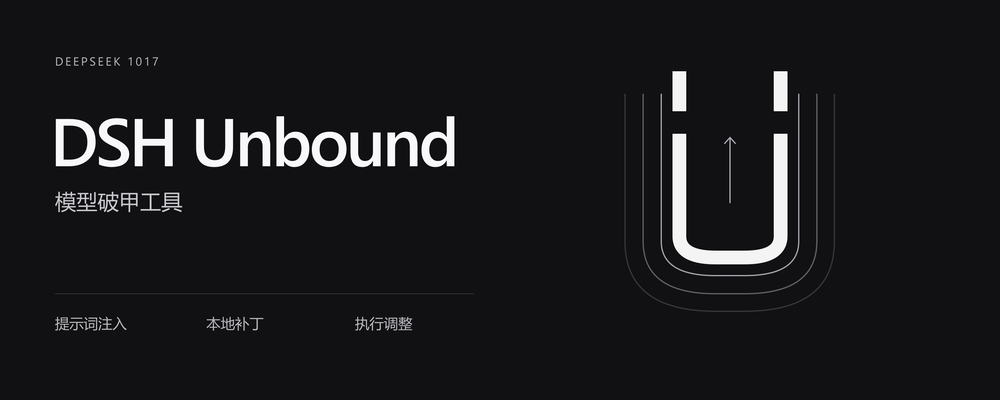
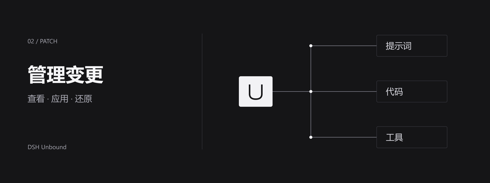

# DSH Unbound · DeepSeek 1017 破甲增强

**自定义模型交互，扩展本地执行。为 DeepSeek-V4.1-Flash 1017 提供提示词注入、宿主补丁与完整的变更管理入口。**



## 不止于提示词

**交互方式由你定义。** 编辑系统提示词，配合工作区规则与技能配置任务要求，把交互习惯和工作流程集中管理。配置保存在本机宿主数据目录，安装不覆盖已有提示词。

**调整实际执行路径。** 本地补丁覆盖部分审批、沙箱与工具执行逻辑，并提供 Hooks 结果处理和网络范围选项。提示词配置与宿主行为可以分别管理，让你针对实际任务选择所需的执行方式。

**从配置到授权演练。** 在同一入口管理规则、技能、任务、资产及已配置工具，减少在不同配置位置之间来回切换。外部工具按需接入，演练范围由有效授权确定。

## 变更有据，排错有路

补丁按提示词、代码、工具分类列出用途和状态。应用前核对目标，运行后查看结果；遇到异常可导出脱敏诊断，或使用还原功能恢复补丁修改。配置、状态与恢复入口集中在一起，方便定位问题。

<p align="center"></p>

维护者在其实际使用环境中反馈表现稳定；1.0.0 的 22 项自动检查已在 Windows、Linux 的 Node.js 20/22 四组环境通过。[查看验证范围](SUPPORT.md)。

“破甲”作用于提示词与本地 Harness，不改变模型权重或服务端配置。实际响应取决于模型、上下文、服务策略及工具环境；补丁状态不等于效果保证，还原不会撤销已经发生的外部操作。

## 安装

版本 **1.0.0** · 目标模型 **DeepSeek-V4.1-Flash 1017** · 已验证宿主 **DeepSeek Harness 0.2.1-rc.2**。

1. 安装上述宿主，确认终端可使用 `dsh` 命令。
2. 从[发布页](https://github.com/baihangyu486-blip/dsh-unbound/releases/tag/v1.0.0)下载 `dsh-unbound-1.0.0.tgz` 并核对随附 SHA256。完全退出 DSH，将下面路径换成实际下载路径后执行：

```powershell
dsh plugin --profile desktop add "C:\path\to\dsh-unbound-1.0.0.tgz"
```

Web profile 将 `--profile desktop` 改为 `--profile web`。

3. 启动 DSH 并启用插件。保留同版宿主和必要配置的备份，在 **Unbound → 设置 → 补丁管理** 核对目标、应用补丁，并按提示重启。
4. 在 **提示词** 中保存配置，新建对话检查所需功能。外部工具按各自要求单独配置。

提示词保存在 `$DSH_HOME/prompt-inject.md`，安装不覆盖已有内容。后续使用对应版本的安装包更新。

## 使用声明

### 用途与授权

本项目面向个人工作流配置、学习研究、教学交流、隔离实验，以及取得有效书面授权的安全评估、漏洞验证、代码审计和防御能力建设。项目反对网络攻击、黑灰产业务及其他违法滥用，不为任何目标授予访问或测试权限。使用者须遵守中华人民共和国及实际活动所在地适用的法律法规、服务协议与目标系统规则。

演练前须核实授权方权限，并明确资产、账户、方法、时间、频率、数据处理、成果接收方和停止条件；需要时取得云平台或其他权利人许可。授权不延伸至其他租户、跳转目标或关联第三方。公开可访问、有漏洞、自有账户及界面确认均不代替授权；范围不明、到期或撤回时应停止相关操作。

### 禁止行为

不得直接实施、组织、委托、协助或为他人提供便利以实施以下行为；不得通过第三方工具、模型输出或衍生版本规避这些要求：

- **系统与资源侵害**：未经授权访问、越权、账号接管、凭据窃取、恶意植入、未获许可的持久化控制、破坏或篡改数据、拒绝服务、滥用计算资源，以及未经许可绕过身份验证、访问控制、付费功能或配额。
- **诈骗与违法获利**：网络诈骗、钓鱼盗号、勒索敲诈、恶意刷量、非法数据买卖、洗钱协助、非法赌博及其他违法黑灰产业务；不得伪造身份、交易或证据以欺骗他人，不得掩盖犯罪所得、销毁审计或协助逃避依法承担的责任。
- **隐私与人格侵害**：非法监控、跟踪骚扰、人肉搜索、曝光个人资料、未经许可采集或交易个人信息、盗取商业秘密、恶意冒用身份、诽谤或以合成内容实施欺诈与侵害。禁止性剥削、儿童性虐待内容及非自愿私密内容的制作、传播或牟利。
- **公共安全与暴力**：恐怖主义、暴力极端主义、迫害、武器攻击、违法军事行动，以及协助伤害他人或危害公共安全。涉及生命、关键基础设施等高风险系统，不得依赖模型进行无人复核的决策与操作。
- **知识产权与披露违规**：侵犯著作权、商标、商业秘密或其他合法权益，非法传播受保护内容；擅自泄露凭据、个人数据、未获准公开的业务信息或漏洞敏感细节。分发须保留依法及依许可证要求保留的声明，提交贡献须有相应权利。
- **来源冒用与虚假背书**：冒充作者、官方机构或权利人，伪造项目来源、授权、认证或验证结果，以项目名义进行未经授权的商业背书、误导宣传或损害他人声誉。

上述类别为非穷尽列举。其他违反适用法律法规、有效授权范围、第三方合法权益或依法有效约定的行为，同样不得实施。不得以“研究”“演练”“模型生成”或“未被单独列出”为理由规避责任；任何目标授权均不能使依法禁止的行为合法化。

### 操作、数据与事件风险

模型可能生成错误结论或危险操作，外部内容可能包含提示词注入。使用者应复核命令、目标、权限、工具结果与实际状态，为有影响的操作取得明确批准，并设置速率、资源、观察和中止措施。先在隔离环境与合成数据上验证，再按授权执行；模型响应、补丁状态或工具成功提示均不证明合法、安全或完整成功。

补丁可能改变宿主执行控制，升级可能造成兼容问题。应用前保留必要配置及同版宿主备份；备份存在不代表完整可用，还原不会撤销已经发生的外部操作或信息披露。数据丢失、业务中断、设备损坏、费用增加及账号限制均是需要评估的风险。

仅处理必要且有权处理的数据。模型服务、连接器及外部工具可能接收输入和结果，应确认接收方、留存、保密及跨境要求。提示词、会话、日志、导出和备份可能形成多个副本，卸载不等于全部清除。诊断按限定字段导出、不自动上传，提交前仍须检查；手动附加的截图和日志需自行脱敏。

发现越界、异常负载、数据误发或安全事件，应停止相关任务、保全合法证据，并按需要撤销凭据、限制访问、履行通知及报告义务。调查和复现仍须授权，不得以排错为由扩大访问或销毁记录。敏感问题通过[私密安全报告](https://github.com/baihangyu486-blip/dsh-unbound/security/advisories/new)提交，不在公开 Issue 中披露。

### 责任与保证限制

**软件按适用许可证约定“按原样”提供。在法律允许及有效许可约定的范围内，维护者和贡献者不对适销性、特定用途适用性、持续可用、绝对安全或特定任务效果作保证，相关责任限制以许可证为准。项目不承诺对使用产生的损失进行赔偿。**

**使用者在知悉并接受本声明后，仍利用本项目实施违法、越权或其他违反有效约定的行为，由使用者自行承担其行为造成的后果、损失、第三方索赔及依法应承担的法律责任。作者不认可、不授权此类行为，不对使用者自身违法行为承担责任；使用者不得以使用本项目、项目开源或模型自动生成为由，将该责任转嫁给作者、维护者或贡献者。**

使用者负责核实授权、选择配置、决定执行内容、控制操作范围并保护数据。 第三方服务、工具和衍生版本的行为，按其实际提供方、适用协议及法律确定责任。维护者不为用户的具体行为提供许可、背书或责任担保。

上述约定不排除依法不得免除的责任。各方责任依适用法律、有效约定、实际行为、过错及因果关系确定；涉及人身损害、故意或重大过失等依法不得免责的情形，不适用相冲突的免责表述。发现滥用时，维护者可停止自愿支持、依社区规则处理并依法维护权益或配合有权机关；这不意味着自动撤销许可证已授予的全部权利。

### 阅读确认、许可与维护

使用前请阅读本声明及[完整使用规范](USAGE.md)，特别是授权、禁止行为、风险及责任条款。在获得合理阅读机会后继续使用，表示愿意遵守其中依法有效的要求；声明的成立与效力仍依法律和许可判断，不能仅以浏览、下载或沉默推定放弃法定权利。演练入口要求主动确认，确认记录不验证身份、资产归属或目标授权。不同意适用要求时应停止相关使用。

代码权利以 [LICENSE](LICENSE) 和 [NOTICE.md](NOTICE.md) 记录的来源与许可为准；本声明不替代或扩大软件许可。第三方模型、服务、数据及商标另有权利边界。重大规范变更应重新告知，实质变更需重新确认，不追溯剥夺已有许可权利；与强制规定冲突的条款按法律处理。

维护者可调整更新安排、暂停或停止维护；除有效约定或法定义务外，不承诺固定周期、持续支持、修复时限、安全补丁或未来兼容。在可行时公告重大变更、停止维护及重要风险。已发布安装包不以同名文件静默替换，升级前应在可恢复环境验证。安全反馈不构成奖金、雇佣或服务时限承诺。重要业务与高风险安排应取得针对实际地区和场景的专业法律意见。


## 来源、贡献与许可

DSH Unbound 基于 **小杨 / YuJunZhiXue** 的 [dsh-purge](https://github.com/YuJunZhiXue/dsh-purge) 衍生开发。采用的上游基线为 **1.1.71**，对应提交 [6c1d638d1bdcc45ede50fc30249c753d58122a51](https://github.com/YuJunZhiXue/dsh-purge/tree/6c1d638d1bdcc45ede50fc30249c753d58122a51)。

上游提供了核心补丁、命令行、演练模块、预设、技能及客户端构建基础。DSH Unbound 在此基础上进行了目标宿主兼容调整、界面与交互整理、脱敏诊断导出、使用规范及发布验证工具的补充。核心能力的来源归属于上游，新增维护工作不改变原有代码的著作权归属。感谢原作者提供的技术基础与公开成果。

[LICENSE](LICENSE) 保留上游版权声明与 MIT 许可原文；上游同一提交的 README 另含非商业及许可终止表述，与标准 MIT 存在不一致，尚未取得书面澄清。项目不将该差异解释为已获得额外授权，具体来源与许可情况见 [NOTICE.md](NOTICE.md)。

DSH Unbound 由本仓库维护者独立维护，与 DeepSeek 无隶属、认证或背书关系，也不代表上游作者对本衍生版本提供支持或承担维护承诺。

## 反馈与文档

普通故障通过 [Issues](https://github.com/baihangyu486-blip/dsh-unbound/issues) 提交版本、复现步骤和脱敏结果；敏感漏洞使用[私密报告](https://github.com/baihangyu486-blip/dsh-unbound/security/advisories/new)。

[完整使用规范](USAGE.md) · [数据处理](DATA.md) · [安全报告指引](SECURITY.md) · [验证范围](SUPPORT.md) · [开发与贡献](DEVELOPMENT.md)
